# Okta SSO / MFA Lifecycle Lab

Hands-on lab, Sep 2026.

This is an access ticket from start to finish in Okta: a new user needs an app, so they get it through a group, the app makes them prove who they are with two factors, and they sign in with SAML single sign-on. When the work is done, I pull them out of the group and the app disappears. Group membership is the switch, so access comes and goes without deleting the person.

## What I built

- An Okta Integrator Free org and test user **testuser@salamiam.com**, enrolled in Okta Verify.
- Group **SSO-App-Users** for the people allowed into the lab app.
- **Lab SAML App** (SAML 2.0) pointed at the IAMShowcase test service provider (ACS `https://sptest.iamshowcase.com/acs`, Audience `IAMShowcase`, Name ID EmailAddress).
- App assigned to the group, with a sign-on policy of **Any two factors**.
- **Grant proof:** the tile shows on testuser's dashboard, and SSO lands on "Hello testuser@salamiam.com" with a Success assertion from Okta.
- **Revoke proof:** removed testuser from the group, and the tile is gone.

## What I learned

In my own words (light grammar only): "I've built test users and groups and assigned applications to show how to move someone through what's asked of me if they need to be added to things, and built protections in: having them sign into app access, having them verify through the Okta Verify authenticator, giving them single sign-on, putting them through lifecycle changes, and removing them when they are done with a project or assignment. That keeps them secure, so they only have access to what they need and can't get breached. If a breach happened, most likely it's because they gave someone access, because I closed all doors."

Interview line: "In Okta I set up a SAML app with SSO, required two factors to sign in, and gave it to one group so only those users saw the app. When the test user was done, I took him out of the group and the app disappeared from his dashboard."

## Key screenshots

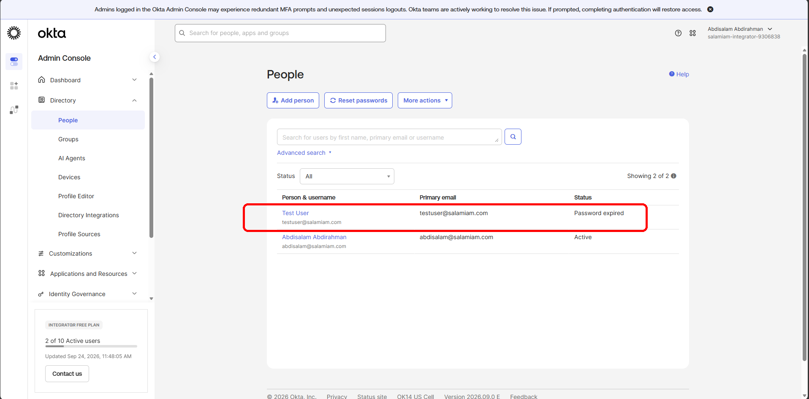
Created Test User in the Okta admin console People directory.

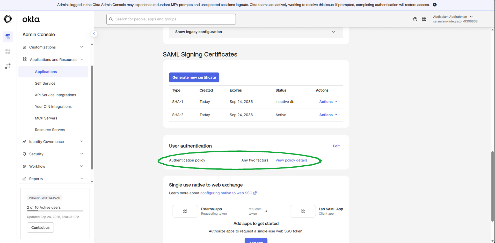
App sign-on policy requires any two factors before SAML access.

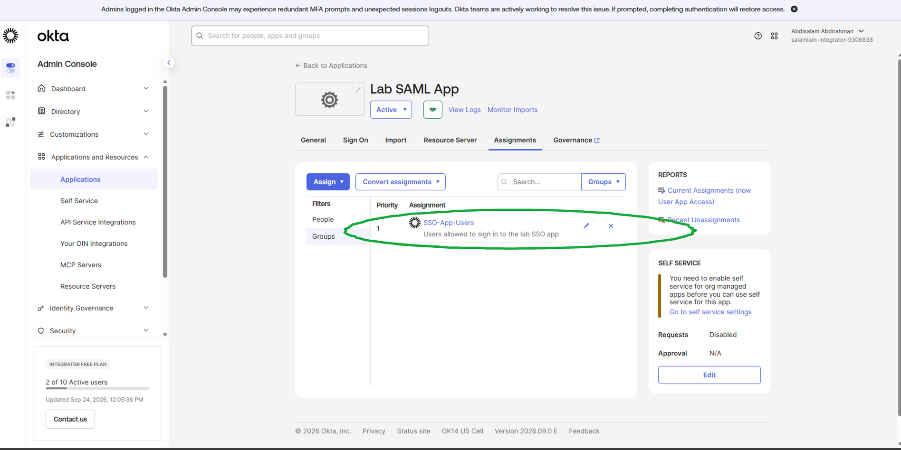
Assigned the Lab SAML App to the SSO-App-Users group only.

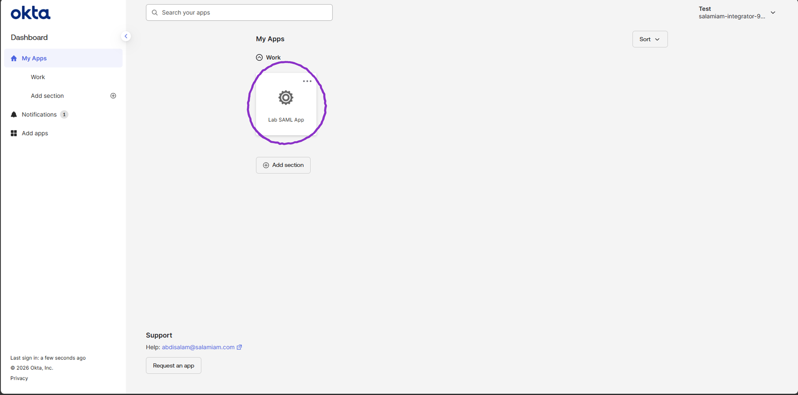
Test User sees the Lab SAML App tile on their dashboard.

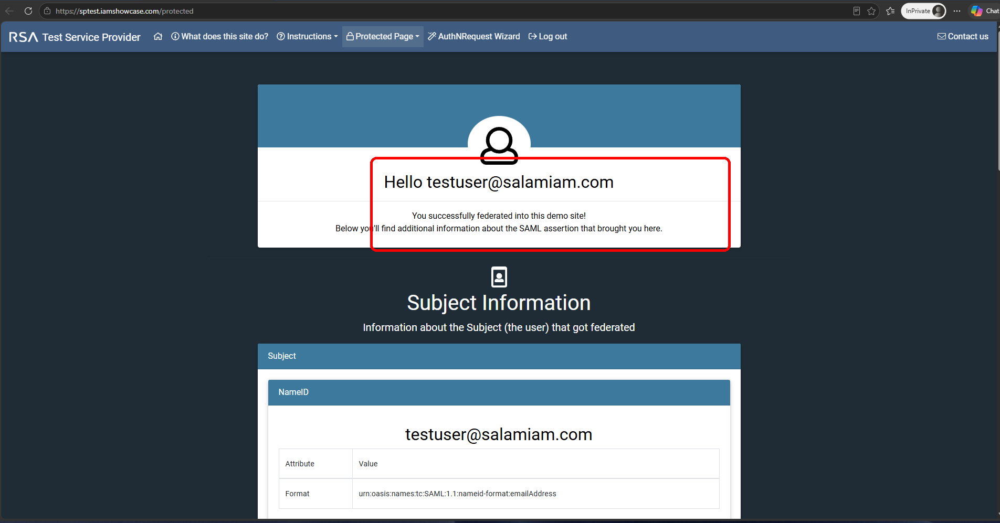
SAML single sign-on succeeded: the service provider greets testuser.

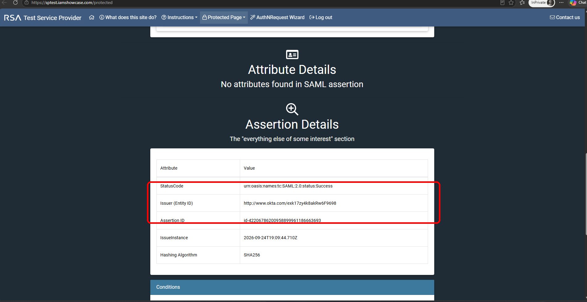
SAML assertion shows a Success status and the Okta issuer.

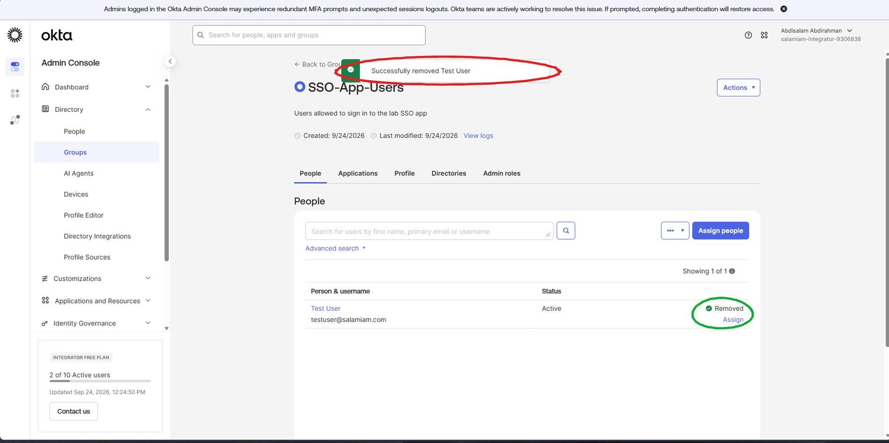
Removed Test User from SSO-App-Users to take away app access.

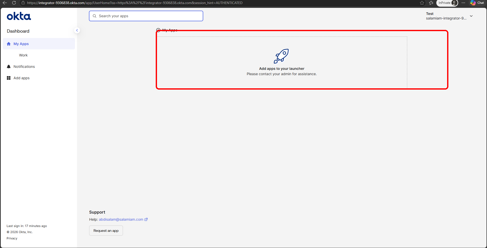
After removal, the app tile is gone from Test User's dashboard.

## Environment

| Object | Value |
| --- | --- |
| Org | Okta Integrator Free |
| Test user | `testuser@salamiam.com` (Okta Verify enrolled) |
| Group | **SSO-App-Users** |
| App | **Lab SAML App** (SAML 2.0) |
| Service provider | IAMShowcase (`https://sptest.iamshowcase.com/acs`, Audience `IAMShowcase`) |
| Name ID | EmailAddress |
| Sign-on policy | Any two factors |

## What broke / issues I fixed

- Nothing broke in this sitting's screenshots. Add Person used "Activate now" without "I will set password", so no temporary-password screen was ever captured.

## Gaps

- The MFA prompt itself (the Okta Verify push) isn't screenshotted. The policy screen and the successful sign-in are the proof.
- salamiam.com is my lab domain, routed to my inbox with Cloudflare Email Routing. The emails shown are lab addresses, not a personal inbox.

Full proof (all screenshots)

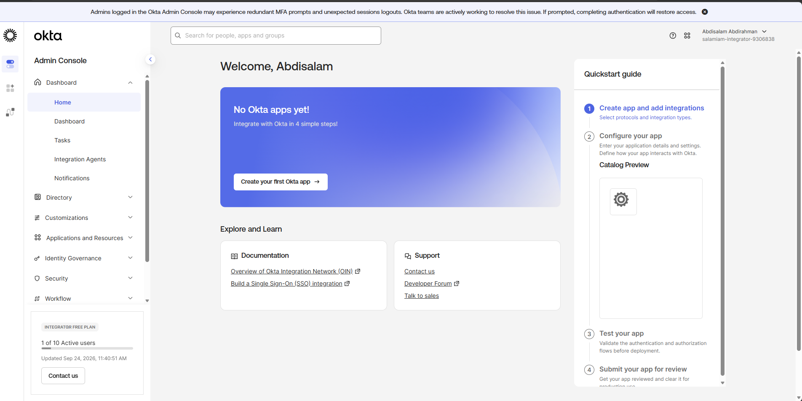

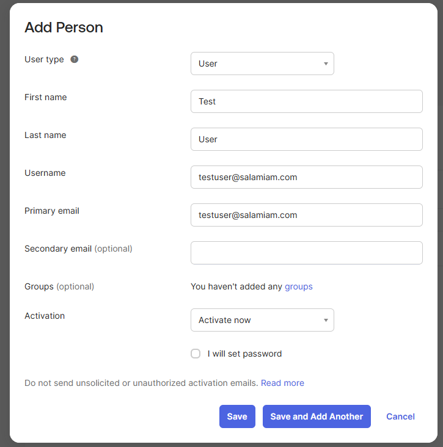

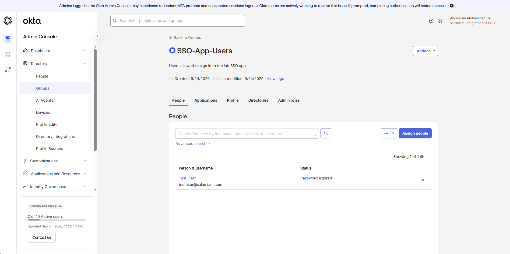

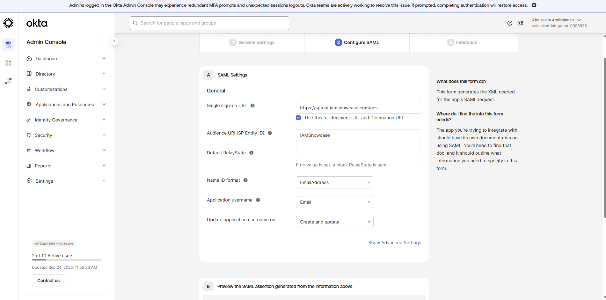

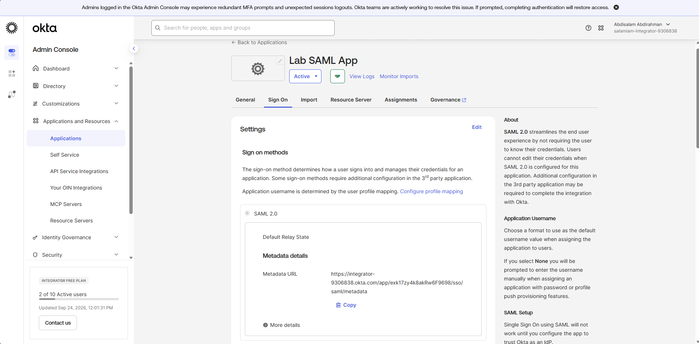

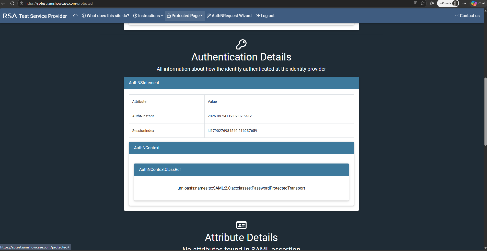

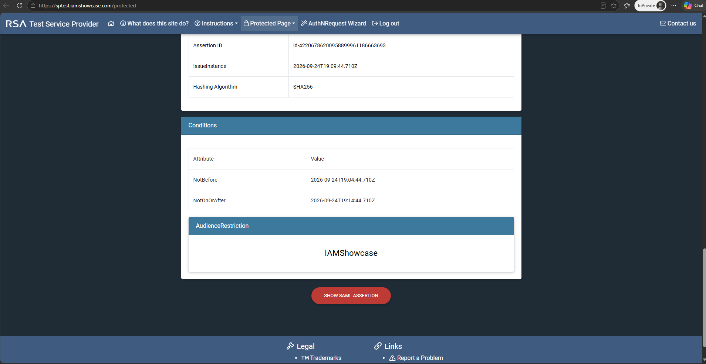

